<p align="center">
  
</p>

<h1 align="center">Giffact</h1>

<p align="center">
  Contorne GIFs animados quadro a quadro com linhas vetoriais limpas e sensíveis à pressão, no espírito das camadas de linework do PaintTool SAI, e exporte só as linhas em PNG ou SVG na resolução que quiser.
  <br />
  <a href="README.md">English</a> · <b>Português (Brasil)</b>
</p>

<p align="center">
  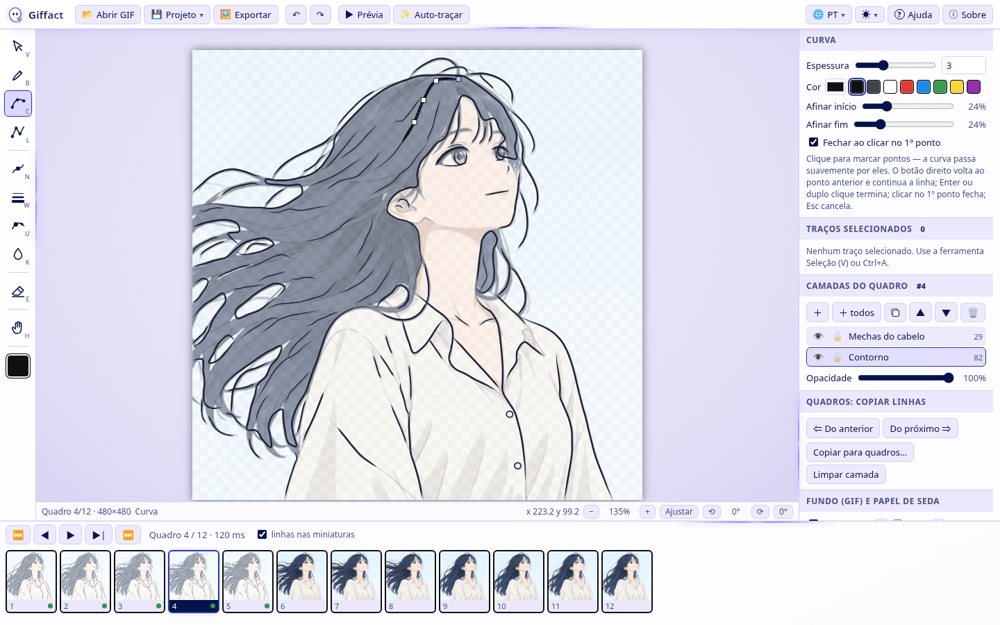
</p>

O Giffact funciona como app de desktop para Windows e Linux (Electron) e como página web comum. Tudo roda localmente: seus GIFs e projetos não saem do seu computador.

## Recursos
- **Abrir GIF** (botão, `Ctrl+O` ou arrastar para a janela). PNG, JPG e WebP abrem como um quadro. Descarte (disposal), quadros parciais, transparência e o tempo de cada quadro são lidos corretamente.
- **Linha do tempo** com todos os quadros. Ela rola na horizontal, tem miniaturas virtualizadas e continua leve com centenas de quadros.
- **Camadas por quadro:** adicionar, excluir, renomear, reordenar, ocultar, bloquear e ajustar a opacidade. "+ todos" cria a camada em todos os quadros.
- **Ferramentas vetoriais** (como no SAI):

  | Tecla | Ferramenta | Uso |
  |---|---|---|
  | `C` | **Curva** | Clique para marcar pontos e a curva passa suavemente por eles. O **botão direito** (ou `Backspace`) volta ao ponto anterior e continua a mesma curva; `Enter` ou duplo clique termina; clicar no 1º ponto (ou `Shift+Enter`) fecha; `Esc` cancela. |
  | `L` | **Linha reta** | Igual à curva, mas com segmentos retos (o botão direito também volta um ponto). `Shift` trava em passos de 15°. |
  | `B` | **Caneta** | Mão livre com **estabilizador** (`Shift+[ ]`). Vira uma curva editável ao soltar. |
  | `N` | **Editar pontos** | Arraste pontos, arraste a linha para inserir um ponto, `Alt+clique` apaga um ponto, `Ctrl+arrastar` move o traço inteiro. |
  | `W` | **Espessura** | Arraste sobre um traço para engrossar ou afinar o traço todo. |
  | `U` | **Pressão** | Muda a espessura só num ponto. |
  | `K` | **Cor** | Clique num traço para aplicar a cor atual. |
  | `E` | **Borracha vetorial** | Traço inteiro, **até a interseção** (como no SAI) ou área. |
  | `V` | **Seleção** | Mover, escalar e girar com alças. `Delete` apaga. |
  | `H` | **Mão** | Move a vista (ou segure `Espaço`, ou use o botão do meio). |

- **Mesa digitalizadora:** a pressão é gravada em cada ponto pelos Pointer Events (Wacom, Huion, XP-Pen, Surface…), e as pontas afinam automaticamente no início e no fim.
- **Papel de seda** (onion skin), **copiar linhas** do quadro anterior ou do próximo (`Alt+←/→`) e **copiar para um intervalo de quadros** (`Ctrl+Shift+V`).
- **Desfazer/refazer por quadro**, além de zoom, mover e **girar a tela**.
- **Prévia animada** (`P`) no tempo do GIF ou com FPS próprio.
- **Auto-traçar (experimental):** um rascunho das bordas do quadro em curvas editáveis, numa camada separada.
- **Exportar** (`Ctrl+E`):
  - PNG ou SVG, em qualquer escala (2×, 4×…) ou com largura/altura exatas.
  - Fundo transparente, branco ou colorido, com ou sem o GIF por baixo.
  - Você escolhe quais camadas e quadros entram.
- **Projetos** (`Ctrl+S`): arquivos `.giffact` com o GIF embutido. Projetos antigos `.gifline`/`.json` do GIF Linework continuam abrindo.

## Novidades da 1.1.1
- Ferramentas Curva e Linha: **o botão direito agora volta ao ponto anterior** e mantém a linha em andamento, em vez de encerrá-la. Para terminar, use `Enter` ou duplo clique.

## Novidades da 1.1
- Novo nome e ícone: **Giffact**.
- Menu **Projeto**: Novo, Abrir, Salvar (`Ctrl+S`), Salvar como (`Ctrl+Shift+S`) e Exportar PNG/SVG.
- **Tema escuro** com degradê azul-marinho/índigo/violeta e faixas neon lavanda animadas e discretas nas bordas (nunca sobre a tela de desenho), mais um **tema claro** lavanda/branco. Os dois seguem o tema do sistema por padrão.
- **Opção de desligar as animações neon**: elas respeitam o `prefers-reduced-motion` e pausam quando a janela fica oculta.
- **10 idiomas**: English, Português (Brasil), Español, Français, Deutsch, Italiano, 日本語, 中文（简体）, 한국어 e Русский. O idioma segue o do sistema por padrão e pode ser trocado no menu 🌐.
- Janelas de **Ajuda** (passo a passo e atalhos) e **Sobre**.

## Capturas de tela
<table>
  <tr>
    <td align="center" width="50%">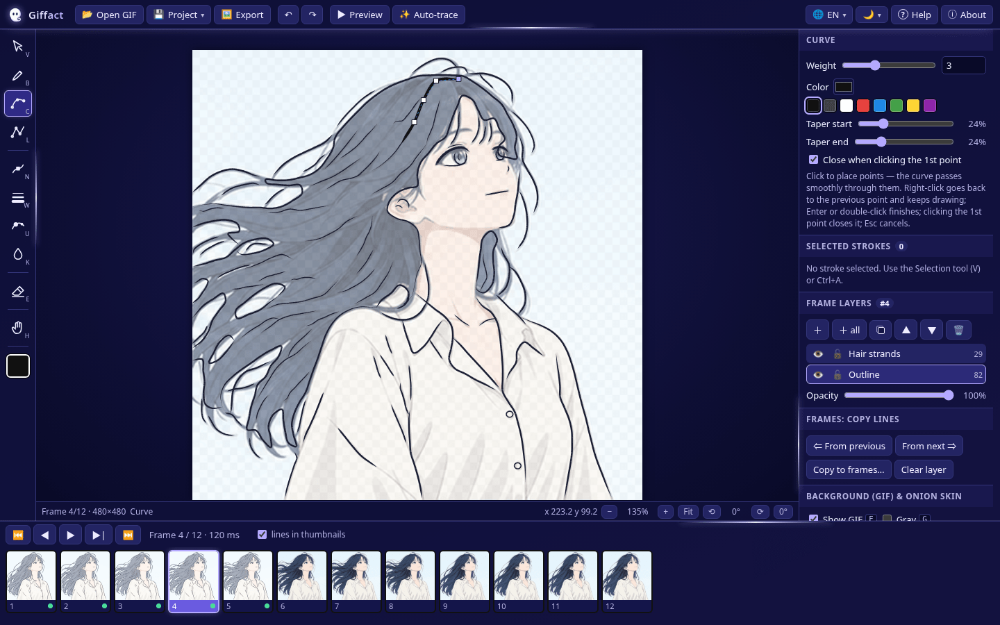<br /><sub><b>Tema escuro</b> com neon</sub></td>
    <td align="center" width="50%">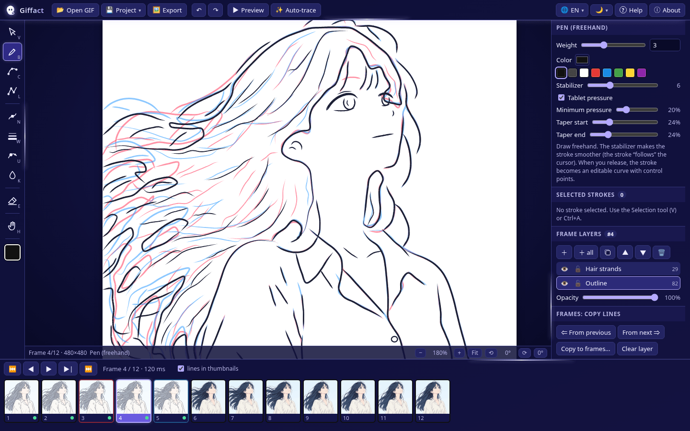<br /><sub><b>Papel de seda</b>: quadro anterior em vermelho, próximo em azul</sub></td>
  </tr>
  <tr>
    <td align="center" width="50%">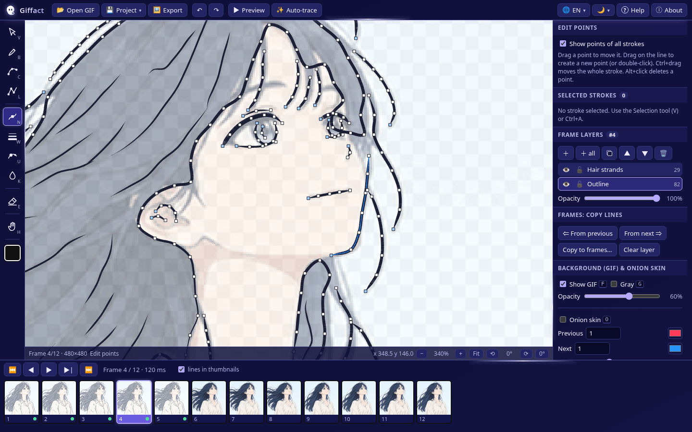<br /><sub><b>Editar pontos</b>: toda curva continua editável</sub></td>
    <td align="center" width="50%">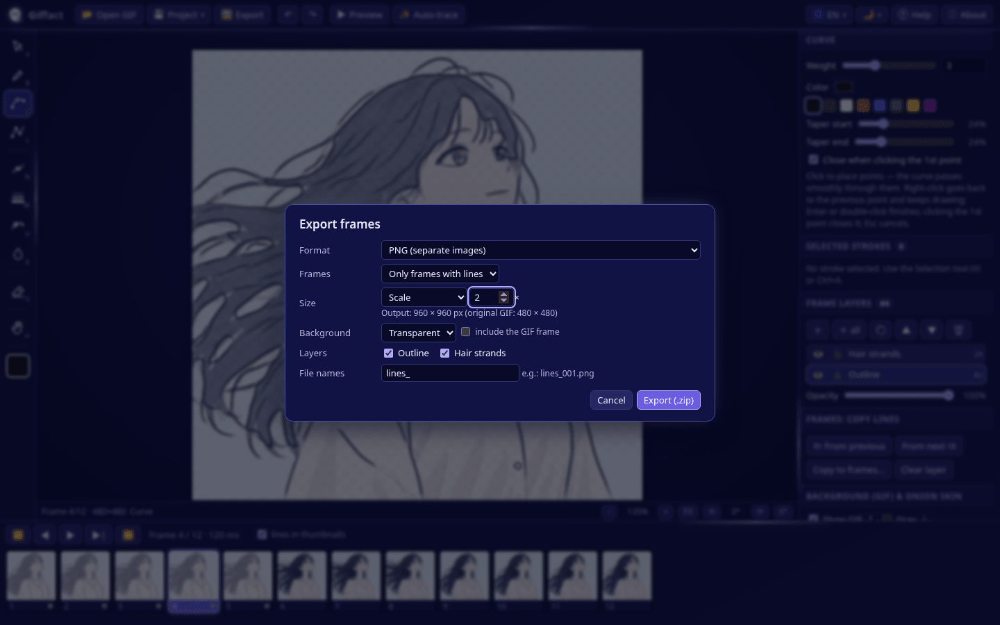<br /><sub><b>Exportar</b> PNG/SVG em qualquer escala</sub></td>
  </tr>
  <tr>
    <td align="center" width="50%">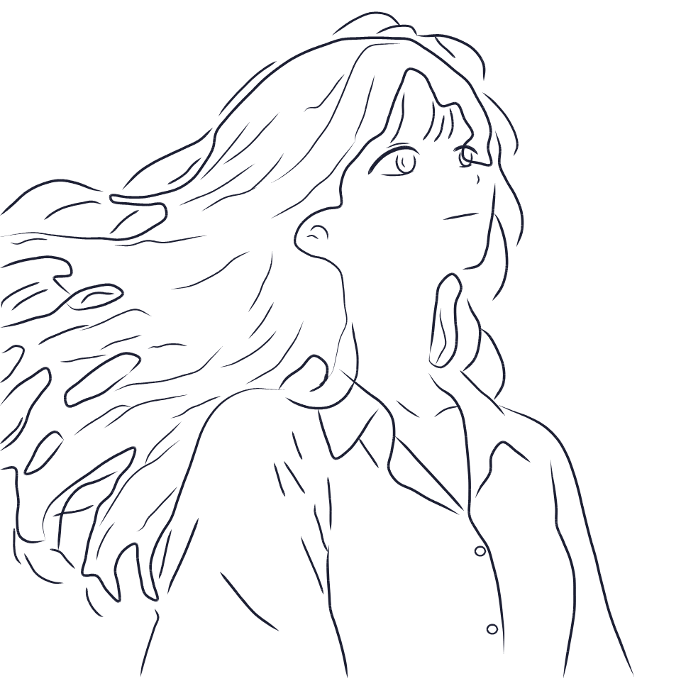<br /><sub>O resultado: só as linhas, exportadas em 2× (960×960)</sub></td>
    <td align="center" width="50%">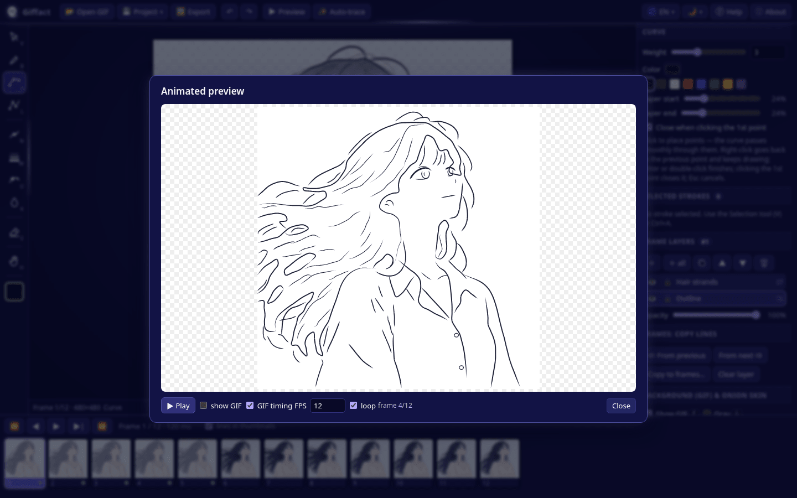<br /><sub><b>Prévia animada</b> dos quadros traçados</sub></td>
  </tr>
  <tr>
    <td align="center" width="50%">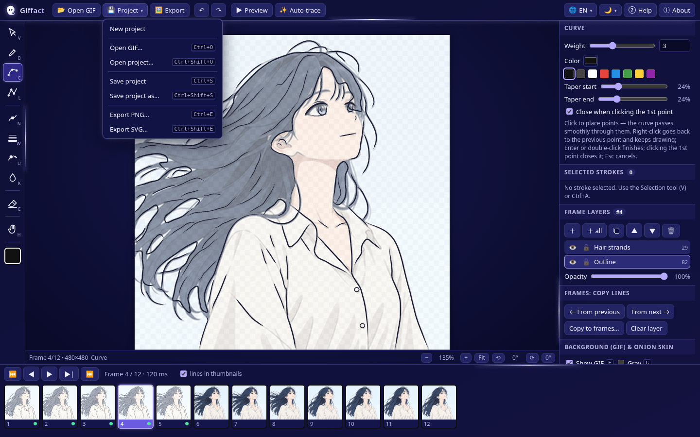<br /><sub>Menu <b>Projeto</b></sub></td>
    <td align="center" width="50%">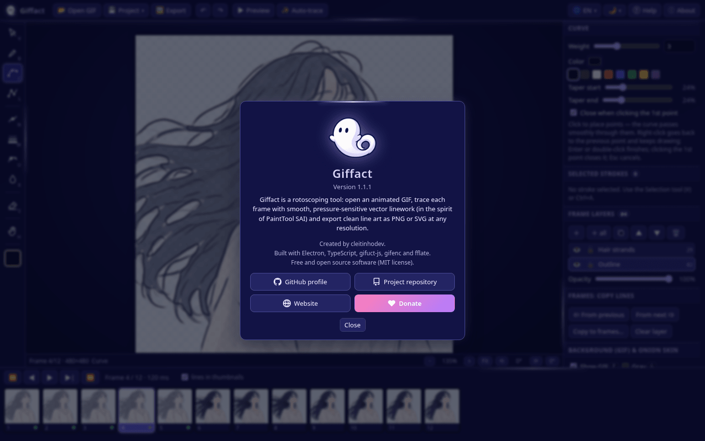<br /><sub>Janela <b>Sobre</b></sub></td>
  </tr>
  <tr>
    <td align="center" width="50%">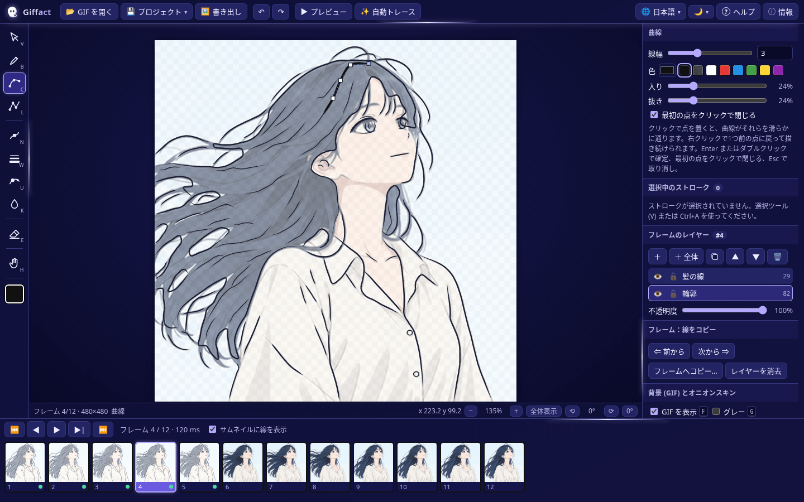<br /><sub>10 idiomas (aqui: 日本語)</sub></td>
    <td align="center" width="50%">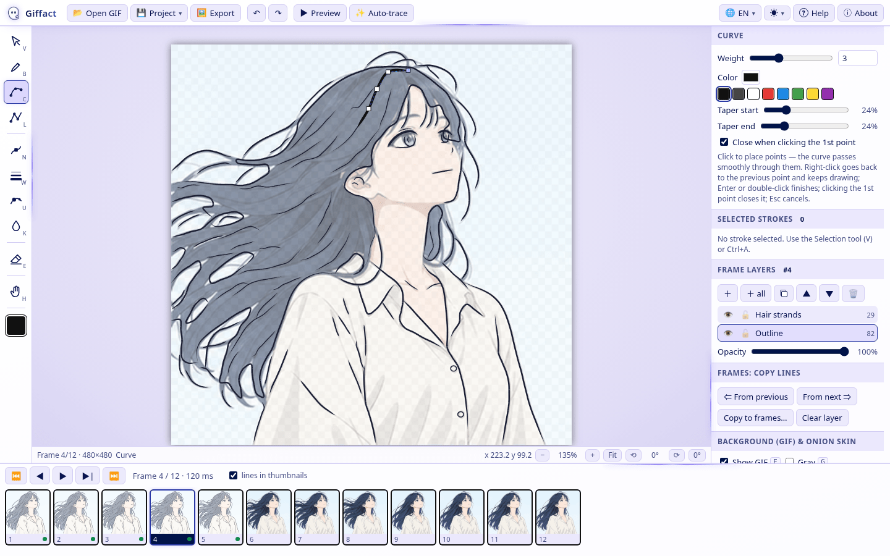<br /><sub><b>Tema claro</b> (em inglês)</sub></td>
  </tr>
</table>

## Download
Baixe a versão mais recente na **[página de Releases](https://github.com/cleitinhodev/giffact/releases/latest)**. Cada release traz as somas SHA-256 em `SHA256SUMS.txt`.

| Sistema | Arquivo | Como abrir |
|---|---|---|
| Windows 10/11 x64 | `Giffact-1.1.1-windows-portable.exe` | Um executável único e portátil, sem instalação. É só abrir. |
| Windows 10/11 x64 | `Giffact-1.1.1-windows-x64.zip` | Descompacte e abra o `Giffact.exe`. Ele abre mais rápido que o portátil. |
| Linux x64 (qualquer distro) | `Giffact-1.1.1-linux-x86_64.AppImage` | `chmod +x Giffact-1.1.1-linux-x86_64.AppImage` e execute. |
| Debian / Ubuntu / Mint | `Giffact-1.1.1-linux-amd64.deb` | `sudo apt install ./Giffact-1.1.1-linux-amd64.deb` e abra o Giffact pelo menu de aplicativos (Gráficos). |
| Linux x64 (manual) | `Giffact-1.1.1-linux-x64.tar.gz` | Extraia e rode `./giffact` dentro da pasta. |

> **Windows:** o executável não é assinado digitalmente, então o SmartScreen pode avisar. Clique em *Mais informações → Executar assim mesmo*.
>
> **Linux:** AppImages precisam do FUSE 2. Se não abrir, instale o `libfuse2` (`libfuse2t64` no Ubuntu 24.04+) ou rode com `--appimage-extract-and-run`.

**Web:** depois do `npm run build`, sirva a pasta `app/` em qualquer servidor estático (por exemplo `npx http-server app`) e abra o `index.html`. Na web, a exportação baixa um `.zip` e o projeto é salvo como download.

## Desenvolvimento
Requer Node 20+.
```
npm install
npm run build        # gera app/ (renderer + main/preload do Electron)
npm start            # abre no Electron
npm run dist:win     # Windows x64: .exe portátil + .zip em dist/
npm run dist:linux   # Linux x64: AppImage + .deb + .tar.gz em dist/
```

## Testes
Os testes de navegador usam `playwright-core` com um Chrome/Chromium local. No Linux, os testes do Electron precisam do `xvfb-run`.
```
npm run typecheck
npm run test:i18n                 # 10 idiomas: paridade de chaves/placeholders, detecção, pseudo-localização, layout de/ru/ja/zh/ko
npm test                          # desenho, edição, borracha, camadas, auto-traçar, exportação PNG/SVG, projetos, pressão
npm run test:features             # menu Projeto, temas, animações neon, troca de idioma, links de Ajuda/Sobre
npm run test:layout               # 300/600 quadros em 1280×720, 1920×1080 e 1024×600
xvfb-run -a npm run test:electron
xvfb-run -a npm run test:features:electron
xvfb-run -a npm run test:layout:electron
xvfb-run -a npm run test:linux   # build Linux empacotado: abre GIF, desenha, exporta PNG (passe o caminho de um .AppImage para testá-lo)
node test/screenshots.mjs [projeto.giffact | animacao.gif]   # regenera docs/screenshots (usa o GIF de demonstração se nenhum arquivo for passado)
```

## Links
- Autor: [github.com/cleitinhodev](https://github.com/cleitinhodev)
- Site: [bugzinho.com](https://www.bugzinho.com/)
- Apoie o projeto: [bugzinho.com/donate](https://www.bugzinho.com/donate)

## Licença
[MIT](LICENSE) © 2026 cleitinhodev
